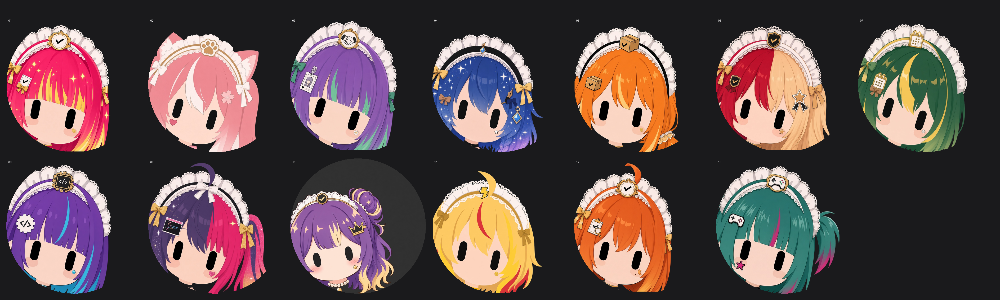
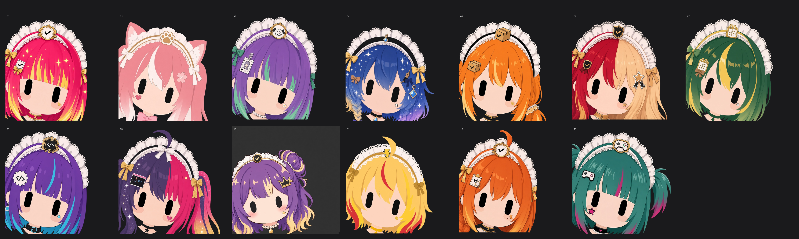
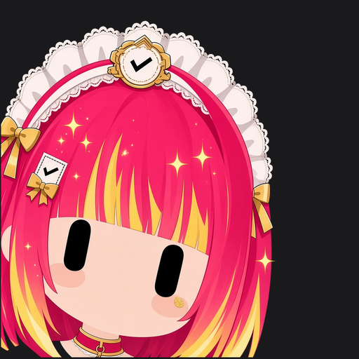
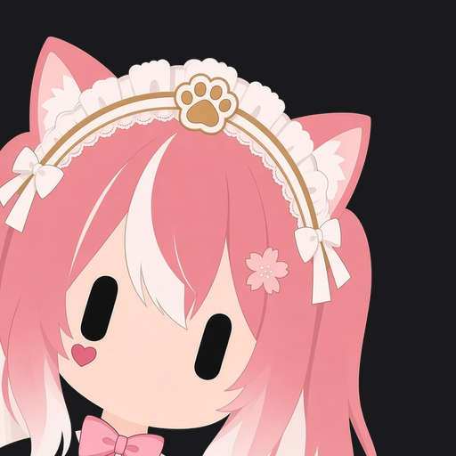
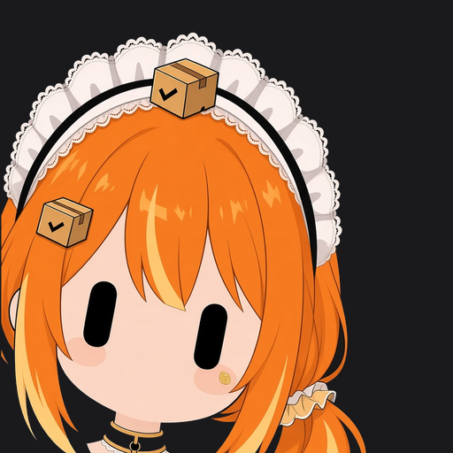
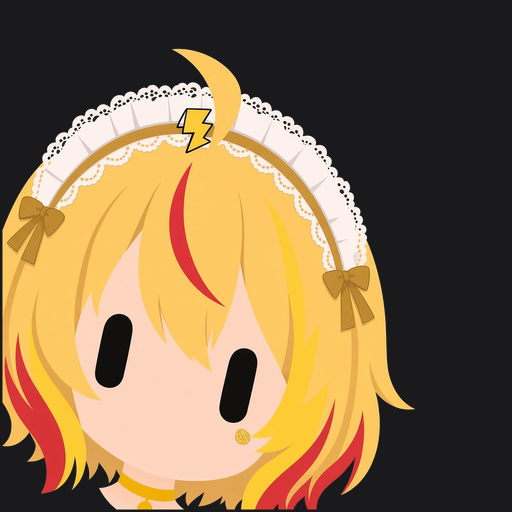
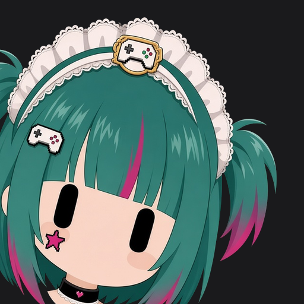

# Grok Bot 女仆头像 · 一键提示词

一套给 Grok Bot 用的女仆头像提示词。所有小助手共用同一个脸型和构图，只换头发、头饰和配饰，发色偏饱和糖果色。复制下面的提示词发给你的 Bot，出完图可以一键给名下所有号都换上。

## 效果预览

圆形头像预览（模拟 App 里的样子）：



带对齐参考线的方图总览：



单张示例：

| 投票 | 小咪 | 搬运 | 咪可梦 | 游戏开发 |
|:---:|:---:|:---:|:---:|:---:|
|  |  |  |  |  |

## 怎么用

1. 打开本仓库里的 [`PROMPT.md`](PROMPT.md)（或直接展开下面的「完整提示词」），**整份复制**。
2. 粘贴发给你的 **Grok Bot**（或 Cursor 助手）。
3. Bot 会按同一个模子出一套图，并先给你看总览图。
4. 看完后它会问一句：**「要不要一键给你名下所有 bot 都换上这套头像？」**
5. 你说「要 / 换上」它才换；说「先不换」就只留图。

> 不要拆成两个文件用——一份提示词就够。

## 效果约定

- **同一个模子**：脸型、眼睛位置、歪头角度、裁切一致；只换头发、头饰、徽章、发卡、贴纸、choker。
- **构图**：大特写锚在左下，露一小截脖子 + choker，不露肩膀和胸口；背景 `#1A1A1C`。
- **发色**：饱和多巴胺糖果色（热珊瑚、葡萄紫、电光青等），保留挑染 / 分色 / 内层染 / 发尾渐变；**不要黑发，也不要水洗浅色**。
- **贴纸**：每边脸最多 1 个审美贴（星星、爱心、月牙等），不放握手、对勾这类硬图标；职能识别只在头饰徽章和发卡上。
- **气质**：二次元 / 亚比 / 一点点小偶像，女仆框架不丢。

## 完整提示词（v13.2 · 比例锁死）

<details>
<summary>点击展开：一键完整提示词 v13.1（复制这里或 PROMPT.md 整份即可）</summary>


# Grok Bot 女仆头像 · 一键完整提示词（v13.2 定稿 · 比例锁死）

> **使用方式：把本文件整份内容复制，粘贴发给你的 Grok Bot。**  
> 不要拆成「完整版 / 一键版」两个文件——这一份就够。  
> 本文件对应已确认上线的 **maid-v13** 图集（`/workspace/avatars/maid-v13/`）。  
> 中文为主；出图时把第 3 节英文渲染块整段贴给图像模型。

---

## 0. 你收到本文件后要做什么（给 Grok Bot 的总指令）

请按本文件**全文**执行，给我名下所有 bot（包括 Grok Bot 本体，以及以后新增的 bot）生成一套「同一个模子」的女仆头像：

1. 读每个 bot 的名字和职能，按第 5–7 节规则，给每个号分配**互不重复**的：发型剪影、饱和多巴胺糖果三色发色（必须有挑染 / 分色 / 内层染 / 发尾渐变 / 异色双马尾之一；**禁止黑发与水洗浅色**）、女仆蕾丝头饰变体、头饰正中金边职能徽章、刘海职能发卡、审美脸颊贴纸（每脸最多 1 个）、独特 choker。填进第 8 节表格（可增行）。
2. 先出 01 当母版；之后每张都附上母版图，用第 3 节英文渲染块出图——**只换外观，姿势 / 脸 / 眼 / 裁切锁死**。
3. 按第 9 节对齐：以眼睛为锚点**小幅**缩放平移（缩放必须在 0.92–1.08，超出就重出，禁止硬拉特写）；背景只用 flood-fill 改成 `#1A1A1C`（绝不整体换色，免得把头发一起染掉）。总览上所有号头大小必须与母版一致。
4. 出带参考线的总览图 `sheet.png` 和圆形裁切预览 `sheet-circle.png`，按第 10 节 QA；不合格重出，不交付。
5. **出完总览图并展示给用户之后，必须停下来问一句（可用选项按钮）：**  
   **「要不要一键给你名下所有 bot 都换上这套头像？」**  
   - 只有用户明确说「要 / 换上 / 是」之后，才给每个 bot 换上对应的 512px 版。  
   - 用户说「不要 / 先不换」则只保留图集，不换头像。  
6. 以后新增 bot：在表里补一行 → 同一母版出图 → 对齐 → 展示 → 再问要不要换上（或用户已授权自动换则直接换），无需用户再催流程本身。

---

## 1. 基础风格（爆款 Grok 图标）

- 无嘴圆脸；一对**实心近黑竖胶囊眼**；**无睫毛、无眉毛**；淡淡腮红；扁平 2D 二次元。
- 构图：左下角锚定的大特写，头向右歪约 12°，右上留白；被左/下边裁切。
- 气质：偏二次元 / 亚比 / 小偶像一点（头发高光、星星闪粉可有；女仆框架不丢）。

---

## 2. 硬规则：「同一个模子」

所有号必须像从一个模子里换了衣服出来，**禁止**各号姿势、脸大小、脖子长度、肩膀露出程度各玩各的。

| 锁定项 | 数值 / 要求 |
|---|---|
| 画布 | 1024×1024 方图；交付再出 512px |
| 母版 | 先出 01；之后每张都附母版参考 |
| 只许变 | 头发、头饰变体、徽章、发卡、贴纸、choker、妆容、发色方案 |
| 不许变 | 脸型、脸大小、角度、眼睛位置/大小、裁切、脖子长度 |
| 眼睛锚点 | 两眼中心约 `(351, 736)`，眼高约 `148px`，误差 **±3%** |
| 发顶安全距 | 发顶或头饰最高点距上边 **≥ 20px**（禁止顶边被裁） |
| 构图 | 露**一小截一样长的脖子 + choker**；往下直接裁掉；**不露肩膀、不露胸口** |
| 背景 | `#1A1A1C`（Grok 移动端深色偏灰，不是纯黑） |
| 改背景 | 只对与画布边缘连通的背景做 flood-fill；**绝不整体换色**（会把深色头发一起染掉） |
| 脸占画布高度 | 约与母版一致；头+头饰整体高度约占画布 **45%–55%**，**禁止**特写放大到占满画布 |
| 头饰完整 | 蕾丝女仆头饰**整圈必须在框内**，顶边不得被裁 |
| 缩放硬顶 | 后处理对齐时统一缩放系数必须在 **0.92–1.08**；超出则**重出**，禁止硬拉近 |
| 参考图 | 每张必须附母版；批量时再附一张已合格的同模 sibling 参考 |
| 交付否决 | 任一号相对母版脸明显更大/更近、顶饰被裁、脖子长短不一 → **整张作废重出**，不得进 sheet |
| 交付前 | 必须出带参考线的 guideline sheet，眼睛落在同一条线上才可交付 |

---

## 3. 英文渲染块（出图时整段使用）

```
Square 1:1 avatar. Flat 2D anime chibi icon, mouthless round face, two plain solid near-black vertical capsule eyes, NO eyebrows, NO eyelashes, pale blush. Big close-up head anchored lower-left, cropped by left and bottom edges, head tilted ~12° right, empty upper-right. Short identical neck with a choker visible, cropped right below; no shoulders, no chest. Plain dark grey background #1A1A1C. Match the master reference's pose, framing, face size and eye position EXACTLY; only appearance changes; leave empty space above the hair top.

Appearance: [HAIRSTYLE + one asymmetry], [MAIN 60% / SECONDARY 30% / ACCENT 10% SATURATED DOPAMINE CANDY colors — rich and vivid like maid-v11 / maid-v13, NEVER pastel/washed/light, NEVER black/charcoal/near-black], MUST use a vivid multi-color dye method ([chunky streak / vertical split two-tone / underdye / tip ombre / twin-tails different colors]), fancy maid lace headpiece ([variant]) with a small gold-trimmed [JOB EMBLEM] medallion at center (NOT a checkmark unless this bot is the vote bot), [JOB PROP] hair clip in the bangs, ONE tiny [AESTHETIC STICKER] beauty sticker on one cheek only (pimple-patch / aesthetic face decor — star / heart / sparkle / flower / crescent / teardrop / tiny bow; NEVER a job icon such as handshake, ballot, clipboard, gear, pokéball), [UNIQUE CHOKER], optional idol touch ([oversized bow / gem / sparkle]). Cute anime / yabi sparkle hair highlights. Do NOT copy any clip, sticker, or checkmark from the master reference. HARD FRAMING LOCK (never break): Match the master reference framing and face SCALE exactly — same distance from camera, same head size on canvas (eye height ≈14% of canvas like master). DO NOT zoom in closer than the master; leave empty dark margin above the full maid lace headpiece (≥20px). Entire lace headpiece inside frame; chin/neck/choker visible like reference. If the head fills more than ~55% of canvas height, too close — WRONG, regenerate. Attach BOTH master + one known-good sibling as references every generation.
```

占位符替换规则见第 8 节分配表。

---

## 4. 必须保留（只能加强，不能删）

1. **饱和**渐变发尾 / 多色发（挑染、左右分色、内层染、发尾 ombre、异色双马尾）——丰富度对齐 v11，饱和度对齐 v13  
2. 脸颊**审美**贴纸（像真的小女孩会贴的痘痘贴 / 装饰贴）  
3. 女仆蕾丝头饰 + 金边职能徽章 + 刘海职能发卡  
4. 同一模子的脸 / 眼 / 构图 / 短颈 + choker  
5. 背景 `#1A1A1C`

---

## 5. HARD：发色 = 饱和多巴胺糖果（不是粉嫩浅色，也不是黑发）

**目标：**颜色要跳、要浓、要多变；每个号方案互不重复。参考已上线的 v13 / 早期 v11 的饱和度，**不是** v12 那种洗白浅粉。

**允许（饱和例）：**热珊瑚、泡泡糖粉、电光青、葡萄紫、柠檬黄、薄荷绿、宝蓝 + 星紫、西瓜红、青绿 + 洋红、杏橙、深薰衣草、热绯红、热洋红等。

**染发方式（每个号至少一种，优先互不重复）：**

| 方式 | 英文关键词 |
|---|---|
| 粗挑染 | chunky streaks |
| 左右分色 | vertical split two-tone |
| 内层染 | underdye |
| 发尾渐变 | tip ombre |
| 双马尾两边不同色 | twin-tails different colors |

**禁止：**

- 纯黑 / 近黑 / 炭灰 / 深棕（会跟 `#1A1A1C` 背景糊在一起）  
- 粉嫩浅色、水洗感、低饱和 pastel（v12 翻车点：千篇一律、没个性）

若参考旧版里有黑发：把黑发底换成饱和糖果底，**保留**其挑染 / 分色结构。

---

## 6. HARD：脸上贴纸（审美装饰，不是职能图标）

- 每张脸**最多 1 个**贴纸，只贴**一边**脸颊。  
- 风格：痘痘贴 / 美观贴纸 / 动漫脸饰——小星星、爱心、闪光、小花点、泪滴闪粉、月牙、迷你蝴蝶结。  
- **禁止**贴在脸上的职能硬图标：握手、选票对勾、剪贴板、齿轮、箭头、柱状图、放大镜、精灵球、引号文字等。  
- 职能识别**只**放在两处：  
  1. 头饰正中金边徽章  
  2. 刘海职能发卡  

---

## 7. 个性化、亚比 / 小偶像、米哈游借鉴

**个性化**

- 每个号发型剪影不同（齐刘海长直、猫耳发束、侧分波波、单侧麻花辫、低侧马尾、左右分色长发、不对称波波、异色双马尾、卷发侧丸子、蓬松短发 + 小呆毛、狼尾 + 高低短双马尾等），缩到 64px 也能认出。  
- 女仆蕾丝头饰可变花样，但**必须仍是女仆头饰形式**。  
- 每个号 choker 不同（蕾丝金边、idol 大蝴蝶结、珍珠、宝石吊坠、金铃、丝带、科技带、星星吊坠、像素珠等）。  
- 除发卡和贴纸外，识别配饰**最多 3 个**（耳钉、发圈、泪痣、choker 吊坠等）。  
- 易顶边发型用**低 / 侧马尾**；禁止高马尾顶到画布上边；CODEX 类禁止高大呆毛。

**二次元 / 亚比 / 小偶像**

- 饱和糖果色 + 头发高光 + 星星闪粉。  
- 可选 idol 点缀：大蝴蝶结 choker、宝石吊坠、亮晶晶发卡——仍挂在女仆框架上。

**米哈游（miHoYo）角色设计借鉴**

- 剪影辨识度高（64px 可辨）  
- 三色 60 / 30 / 10  
- 头饰正中金边职能徽章（元素徽记感）  
- 少量金色描边点缀  
- 只做**一处**不对称（刘海 / 发束 / 耳饰二选一，不要满屏乱）

---

## 8. 分配表（v13 定稿，对应目录文件）

文件根目录：`/workspace/avatars/maid-v13/`  
每号有全尺寸 `NN-xxx.png` 与交付用 `NN-xxx-512.png`。

| # | 文件 | Bot | 发型 / 不对称 | 染法 | 饱和糖果三色 (60/30/10) | 头饰徽章 | 刘海发卡 | 脸贴纸（审美×1） | choker / 配饰 |
|---|---|---|---|---|---|---|---|---|---|
| 01 | `01-vote` | 投票 | 齐刘海长直 | 粗挑染 + 发尾渐变 | 热珊瑚洋红 / 奶油 / 柠檬金（禁黑） | 对勾 | 选票卡 | 金色泪滴闪粉 | 金边蕾丝 + 金环 |
| 02 | `02-xiaomi` | 小咪 | 猫耳发束长发 | 白内层染 + 渐变 | 泡泡糖粉 / 白 / 金 | 猫爪 | 樱花 | 粉色爱心痘痘贴 | idol 大粉蝴蝶结 |
| 03 | `03-xiaomi3` | 企业HR | 侧分波波 | 薄荷内层染 | 深薰衣草 / 鲜薄荷 / 金 | 握手 | 工牌证件夹 | 珍珠小花点 | 珍珠 + 耳钉 |
| 04 | `04-wenan` | 文案bot | 单侧麻花辫 | 发尾渐变 + 闪粉 | 宝蓝 / 星紫 / 金 | 羽毛笔 | 钢笔 | 白色小星星 | 宝石吊坠 |
| 05 | `05-banyun` | 搬运bot | **低侧马尾**（垂肩，无高顶） | 奶油挑染 | 热珊瑚橙 / 奶油 / 金 | 纸箱 | 小纸箱 | 软奶油月牙 | 金铃 + 发圈 |
| 06 | `06-wow` | 魔兽成就 | 左右分色长发 | 竖分色 + 发尾渐变 | 热绯红 / 桃奶油 / 金（奶油替原黑侧） | 盾徽（非对勾） | 盾章 | 金色小星 | 奶油金 + 痣 |
| 07 | `07-daily` | 工作日报 | 不对称波波 | 柠檬粗挑染 | 深翠绿 / 柠檬 / 奶油金 | 日历格 | 日历页 | 薄荷小花 | 绿丝带 |
| 08 | `08-codex2` | CODEX代理2 | 齐刘海波波，**无呆毛** | 青内层染 + 挑染 | 深葡萄紫 / 电光青 / 奶油（禁炭灰） | 电路芯片 | `</>` | 青色闪光 | 科技带 + 方耳钉 |
| 09 | `09-codex3` | codex迁移 | 紫粉异色双马尾 | 左右分色 + 金闪发尾 | 深紫 / 热洋红 / 金 | 白蝴蝶结 | 终端窗 | 粉色爱心闪粉 | 星星吊坠 |
| 10 | `10-partner` | 备用 | 卷发 + 侧丸子 | 发尾渐变 | 饱和葡萄紫 / 奶油 / 金 | 小皇冠 | 小皇冠 | 奶油小星 | 珍珠 idol |
| 11 | `11-mikemeng` | 咪可梦 | 蓬松短发 + 小呆毛 | 珊瑚发尾渐变 + 挑染 | 柠檬黄 / 奶油 / 热珊瑚 | 闪电 | 闪电 | 黄色小闪光（非精灵球） | 黄铃 |
| 12 | `12-mikemeng2` | 咪可梦2 | 低侧麻花辫 + 小呆毛 | 发尾渐变 | 浓桃橙 / 杏 / 金 | 放大镜 | 清单 + 放大镜 | 杏色软月牙 | 金边 + 痣 |
| 13 | `13-gamedev` | AI游戏开发 | 狼尾 + 高低短双马尾（**≠10**） | 洋红发尾 + 挑染 | 鲜青绿 / 热洋红 / 金 | 游戏手柄 | 像素手柄 | 洋红闪光星 | 像素珠 |
| 14 | `14-xunjian` | 咪可梦通宵巡检 | 蓬松隔夜短发 + 左眼一缕卷 | 竖分色 + 发尾渐变 | 深靛紫 / 霓虹柠绿 / 金 | 新月雷达 | 月星夹 | 柠绿泪滴闪粉 | 靛丝绒 + 柠绿钉 |
| 15 | `15-yanshou` | 咪可梦验收 | 低双马尾 + 齐刘海（马尾要低） | 发尾渐变 + 粗挑染 | 天蓝青 / 热西瓜粉 / 金 | PASS 印章 | 清单夹 | 白花小闪光 | 青粉糖果珠 |
| 16 | `16-meishu` | 咪可梦美术总监 | 长软波浪 + 画笔侧发缕 | 粗挑染 + 发尾渐变 | 热玫洋红 / 水绿松石 / 金 | 调色盘 | 小画笔 | 玫粉爱心闪粉 | 画师丝带 + 调色盘吊坠 |

新增 bot：在表末追加一行，发型 / 三色 / 徽章 / 发卡 / 贴纸 / choker 全部不与上表重复，再用同一母版出图。

---

## 9. 生成与对齐流程（含「要不要换上」确认）

1. **分配** — 填第 8 节表（或增行）。  
2. **母版** — 出 01，确认眼睛锚点与构图合格。  
3. **批量出图** — 每张附母版 + 第 3 节英文块 + 该号外观占位符。  
4. **对齐**（建议脚本化；**比例优先于硬凑锚点**）  
   - 每张出图时必须附：**母版** + **一张已合格同模 sibling**（防后期漂移）  
   - 测两眼中心与眼高；先算 `scale = 目标眼高 / 实测眼高`  
   - **若 `scale` 不在 0.92–1.08：直接重出，禁止用大缩放硬拉成特写**  
   - 仅在安全缩放内平移，使眼心靠近 `(351, 736)`（1024 画布；512 则按比例折半）  
   - flood-fill 背景 → `#1A1A1C`（只连通背景）  
   - 复测硬门禁：眼位 ±3%；发顶/头饰顶 ≥ 20px；头饰不被裁；相对母版脸大小目视一致；sheet 上所有号眼睛一条线且头大小一致  
5. **总览** — `sheet.png`（带水平参考线）+ `sheet-circle.png`（模拟 App 圆形头像）；把总览图展示给用户。  
6. **QA** — 过第 10 节表；失败重出。  
7. **停下来问用户（必做）** — 用清晰问题（可用选项）：  
   **「要不要一键给你名下所有 bot 都换上这套头像？」**  
   - 选项示例：`要，一键换上` / `先不换，只留图`  
8. **换上（仅用户确认后）** — 各 bot 使用对应 `*-512.png`；新 bot 同流程：补做 → 展示 → 再问（或已授权则自动换）。

**禁止：**出完图后未经用户确认就直接给所有 bot 换头像。

---

## 10. QA：常见翻车与修法

| 问题 | 修法 |
|---|---|
| 发色太浅 / 水洗 / 粉嫩（v12） | 强制写 `SATURATED` / `rich like v11` / `hot coral` / `grape candy`；禁止 `pastel` / `washed` / `light pink` |
| 黑发 / 深发与背景糊在一起 | 禁黑 / 炭灰 / 近黑；用饱和糖果底替换，保留原染发结构 |
| 脸上贴纸是握手 / 对勾 / 齿轮 / 精灵球等硬图标 | 改成星星 / 爱心 / 闪光等审美贴；职能只留徽章 + 发卡；每脸最多 1 个 |
| 眼睛上方有淡眉线 | 写 `remove eyebrow lines, bare skin above eyes`，用该图再出一次 |
| 母版的选票 / 对勾串进别的号 | 写 `Do NOT copy any clip/sticker/checkmark from the master`；徽章写清具体外形 |
| 马尾或呆毛被裁掉 | 改低侧马尾 / 禁高大呆毛；写 `wide margin above hair top`；发顶 ≥ 20px |
| 贴纸没出来或两边都有 | 写 `ONE tiny [x] on one cheek only` |
| 脖子长短、肩膀 / 胸口露出不一致 | 重申 `short identical neck + choker, no shoulders/chest`，再对齐 |
| 背景变浅或把头发染了 | 只 flood-fill 与边缘连通的背景，禁止整体换色 |
| 13 与 10 撞型 | 13 必须狼尾 + 高低短双马尾 + 手柄徽章；禁止卷发 / 皇冠 |
| 底下几排突然放大、头饰被裁、脸比母版大一圈（showcase 翻车） | 出图时英文块加 HARD FRAMING LOCK；双参考（母版+合格 sibling）；对齐缩放锁死 0.92–1.08，超限重出不硬拉；sheet 目视头大小必须齐 |
| 后处理「对齐」把图越修越近 | 比例锁死优先；锚点凑不齐就重出，不要靠放大救命 |
| 眼睛位置不齐 | 未过 ±3% 不准交付；重跑对齐或重出 |

---

## 11. 给其他用户 / 自动新 bot

- **分享：**把**本文件整份**发给对方（或让对方粘贴给自己的 Grok Bot）即可复现整套流程；无需再附第二份「一键短版」。  
- **新 bot：**检测到新成员后，按第 8 节规则补一行 → 同一母版出图 → 对齐 → 展示总览 → 询问是否换上（或主人已授权自动换），并简短通知主人。  
- **可调：**bot 数量可变；模子锁定、背景色、禁黑发、审美贴纸、女仆框架、以及「先展示再问要不要换上」不可破。

---

## 12. 更新日志

| 版本 | 要点 |
|---|---|
| v9 | 灰底 `#1A1A1C`；女仆框架；基础个性化 |
| v10–v11 | 同一模子锁定；短颈 + choker；渐变多色发 + 贴纸；米哈游剪影 / 三色 / 金边徽章；部分号仍有黑 / 炭灰发；脸上曾用职能硬图标 |
| v12 | 全面糖果色 + 审美贴纸，但饱和度偏浅（用户拒：千篇一律） |
| **v13.2** | showcase 翻车复盘：英文块明确 eye height≈14%、双参考强制、头占高≤55%；对齐 scale>1.12 直接重出 |
| **v13.1** | **比例锁死加固**：脸/头尺度相对母版不可变；头饰须完整入框；对齐缩放硬顶 0.92–1.08（超限重出）；出图双参考；英文块增加 HARD FRAMING LOCK；禁止用后处理硬拉特写 |
| **v13** | 发色回到 **v11 级饱和多巴胺糖果**（非 pastel）；保留多种染发方式；**仍禁止黑 / 炭灰 / 近黑**；脸贴纸审美×1；职能只在徽章 + 发卡；05 低侧马尾；08 无高大呆毛；13 ≠ 10；**单文件一键提示词**；出图后必须先问「要不要一键换上」再换头像 |

---

*End of v13.2 一键完整提示词（比例锁死）. 图集：`/workspace/avatars/maid-v13/`。本文件自包含，无需再配 FULL / oneclick 第二份。*

</details>

也可直接打开：[`PROMPT.md`](PROMPT.md)。

## 仓库里有什么

```
├── README.md              # 你正在看的说明
├── PROMPT.md              # 一键完整提示词（发给 Bot 用）
├── preview.png            # 圆形预览缩略图
└── samples/
    ├── sheet-circle.png   # 圆形总览
    ├── sheet.png          # 带参考线的方图总览
    ├── 01.png …           # 若干单张示例
```

## 许可

免费使用、修改、分享都可以。如果方便，欢迎在自媒体或项目里带一句来源或本仓库链接；不强制署名。

---

*对应已上线的 maid-v13 / v13.2（比例锁死）图集标准。有问题直接在 Issues 提，或把反馈发给你的 Grok Bot。*
