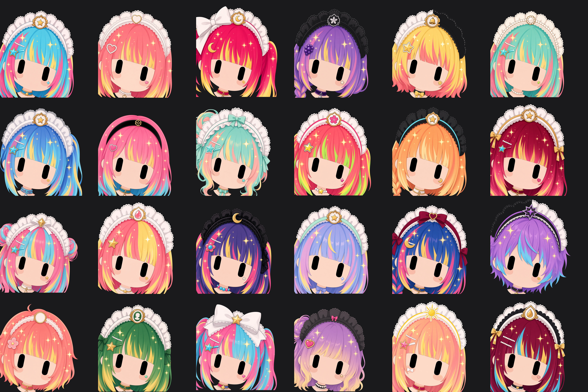
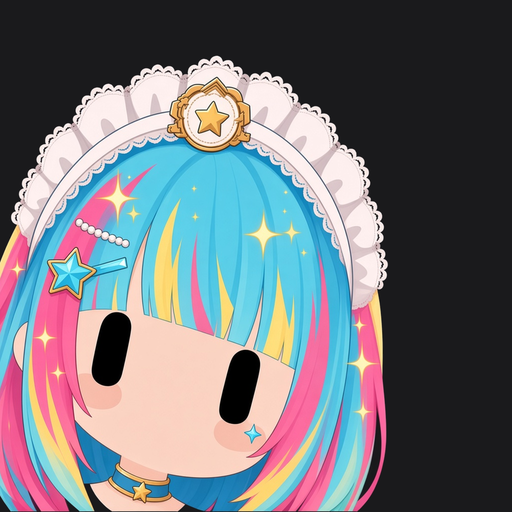
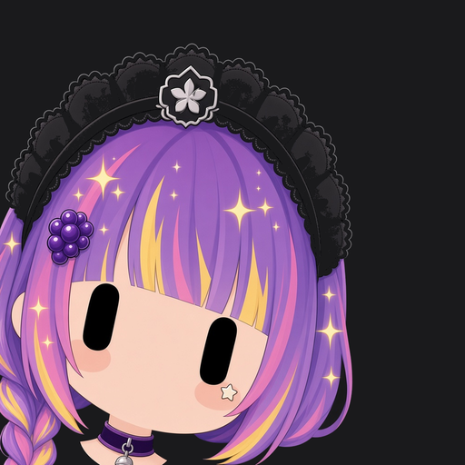
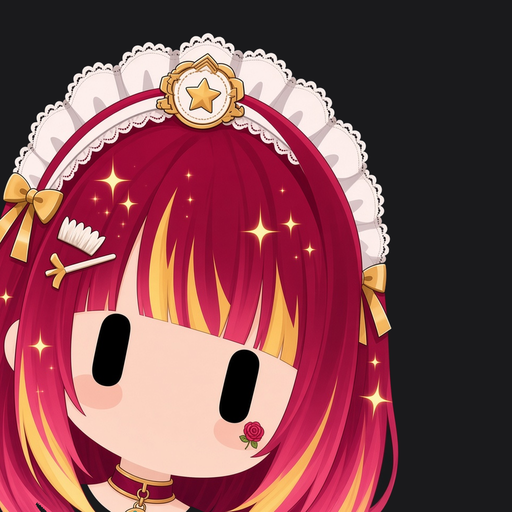
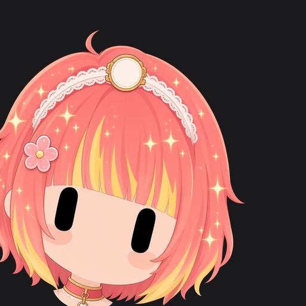
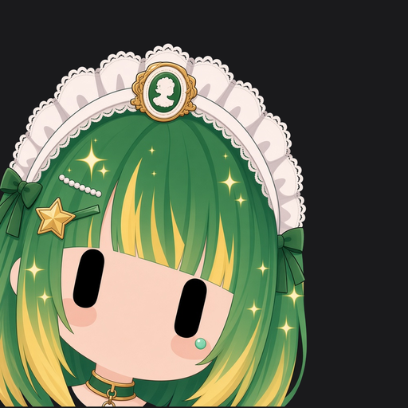
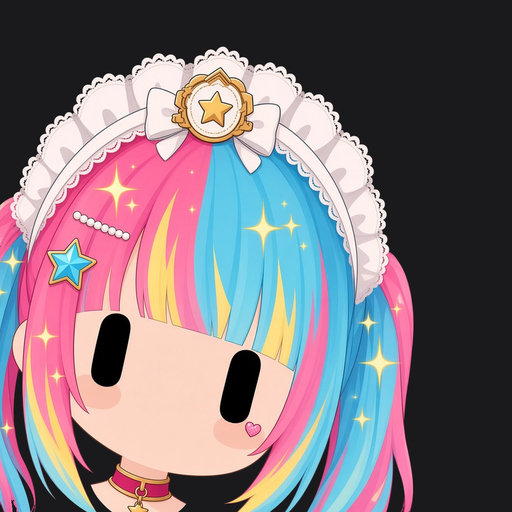

# Grok Bot 女仆头像 · 一键提示词

一套给 Grok Bot 用的女仆头像提示词：全员同一张脸、同一个构图，头发和头饰各不一样；发色亮/正常/深混着来；**深色头饰绝不糊进 `#1A1A1C`**；每个 bot **≥2 个跟职责相关的主题配饰**（发卡 + **多样可爱脸颊贴纸**；创可贴极少，整套最多约 1～2 个）；主 bot 小咪 = 女仆长 + **醒目大金皇冠**（长在蕾丝发箍上，可很大）。把提示词整份丢给你的 Bot，它会先出总览，再问你要不要一键换上。

## 效果预览

24 张同模 showcase（v18：主题配饰 ≥2 + 多样脸颊贴纸 + 深色头饰对比锁；6×4）：



单张示例：

| 亮·电光青 | 正常·薄荷珍珠 | 深·酒红 | 正常·珊瑚 | 深·翠绿 | 亮·粉青分色 |
|:---:|:---:|:---:|:---:|:---:|:---:|
|  |  |  |  |  |  |

## 怎么用

1. 打开本仓库里的 [`PROMPT.md`](PROMPT.md)（或直接展开下面的「完整提示词」），**整份复制**。
2. 粘贴发给你的 **Grok Bot**（或 Cursor 助手）。
3. Bot 会按同一个模子出一套图，并先给你看总览图。
4. 看完后它会问一句：**「要不要一键给你名下所有 bot 都换上这套头像？」**
5. 你说「要 / 换上」它才换；说「先不换」就只留图。

> 不要拆成两个文件用——一份提示词就够。

## 效果约定

- **同一个模子**：脸型、眼睛位置、歪头角度、裁切一致；只换头发、头饰、徽章、发卡、**多样脸颊贴纸**、choker。
- **构图**：大特写锚在左下，露一小截脖子 + choker，不露肩膀和胸口；背景 `#1A1A1C`。
- **发色**：更大胆，约 ⅓ 深宝石发 + 亮挑染，少浅色；亮 / 正常 / 深混搭（深档用宝石底+亮挑染）；保留挑染 / 分色 / 内层染 / 发尾渐变；**不要黑发，也不要水洗浅色**。
- **头饰**：必须是女仆蕾丝/荷叶/缎带 katyusha；**黑白为主**但剪影、材质、滚边、徽章外形要互异（禁止全员同一顶白蕾丝）。
- **深色头饰对比锁（v18）**：黑/炭灰头饰在 `#1A1A1C` 上必须可读——亮滚边（象牙/奶油/银/金/高饱和色 ≥2px）/ 换浅主色（奶油/米/浅灰/酒红）/ 外白内黑荷叶边，三选一；禁止哑光纯黑无边。
- **主题配饰（v18）**：出图前先读该 bot 上下文；每人至少 **发卡 + 脸颊贴纸** 两件主题相关配饰；可选颈链吊坠。**默认多样可爱贴纸**（星/心/月牙/闪光/小花/泪滴/迷你蝴蝶结等，全套互不雷同）；**创可贴极少**（整套最多约 1～2 个 bot），禁止人人创可贴。硬工作图标不直接贴脸。
- **女仆长**：主 bot 小咪头饰更华丽并戴**醒目大金皇冠**（长在蕾丝荷叶发箍上，可很大很明显）；分身（小咪2/3/4…）不要皇冠。
- **气质**：二次元 / 轻亚比 / 一点点小偶像，女仆框架不丢。

## 完整提示词（v18）

<details>
<summary>点击展开：一键提示词 v18（复制这里或 PROMPT.md）</summary>


# Grok Bot 女仆头像 · 一键提示词（v18）

> **给你用的：**整份复制 → 发给你的 Grok Bot。  
> **给 Bot 用的：**先看「做成什么样」，再严格按流程；出图时把 **§3 英文**整段交给画图模型。

---

## 做成什么样（验收标准）

一套图摊开看，应该是：

1. **同一张脸、同一个镜头** — 眼睛齐平、头一样大，像换装不是换人。  
2. **发色大胆有层次** — 至少约 ⅓ 深宝石发（酒红/深青/海军蓝/梅紫/墨绿）配亮挑染；少用浅色粉彩；人人有挑染、双色或渐变；没有黑发、没有水洗浅粉。  
3. **头饰一眼能分清** — 仍是女仆头饰，但以黑白为主，花样、材质、风格各不相同（不是复制同一顶白蕾丝）。  
4. **深色头饰绝不糊进背景** — 黑/炭灰头饰在 `#1A1A1C` 上必须能看清轮廓（亮滚边 / 换浅主色 / 外层白荷叶边三选一）；缩略图也能看出头饰剪影。  
5. **配饰跟职能挂钩（v18 硬规则）** — 每个 bot **至少 2 个主题配饰**（发卡 + 脸颊贴纸 为底线；颈链吊坠可再加），必须读过该 bot 的职责/上下文后再设计；脸颊以**多样可爱贴纸**为主（星/心/月牙/闪光/小花/泪滴/迷你蝴蝶结等互不雷同），**创可贴极少**（整套最多约 1～2 个 bot）；不是冷冰冰的工作图标。  
6. **主 bot 女仆长可辨** — 主 bot「小咪」= 女仆长：头饰更华丽 + **醒目皇冠**（长在蕾丝上，可很大很明显）；分身（小咪2/3/4…）**不要皇冠**。  
7. **先给总览，再换** — 第一次出整套先给主人看；主人说过「直接换、不用再问」后，以后出图就直接通知各 bot 换上，不再让每个 bot 单独弹确认。

做不到以上任一条：重做，不要凑合交付。

---

## 速记（v18 全部规则）

1. 出图前先读该 bot 的上下文。  
2. 每人 ≥2 个主题配饰（发卡 + 多样脸颊贴纸，可加颈链吊坠）；创可贴整套最多约 1～2 个，禁止人人创可贴。  
3. 发色更大胆：一套里 ≥⅓ 深宝石发 + 亮挑染；少浅色。  
4. 保留挑染 / 双色 / 渐变。  
5. 头饰可加时尚元素，但必须一眼是女仆头饰。  
6. v18 深色头饰对比锁照旧。  
7. 主 bot 小咪 = 女仆长 + 皇冠；皇冠必须**长在女仆蕾丝发箍上**（蕾丝荷叶底座 + 缎带系带 + 女仆徽章），不能是单独一顶皇冠；皇冠可以**很大很醒目**（缩略图也能认），分身不戴皇冠。  
8. 偶尔动漫联动彩蛋（约 1/6～1/8，不画 logo/不抄脸）。

---

## 0. 流程（按顺序）

1. **先读上下文**：对每个助手，先看它的名字、职责说明、近期工作/设定，再发明 ≥2 个主题配饰（见 §6）。  
2. 按 §4–§7 给每个助手填 §8 表（外观全不重复；主题配饰列写满）。  
3. 先出 **01 母版**，构图合格再批量。  
4. 每张出图附上：**母版图 + 一张已经合格的同套图**；只用 §3 英文；只改外观。  
5. 对齐：整体缩放只能在 **0.92～1.08**；超出就重画，不要靠放大硬修。背景只把「连到画布边缘的底色」填成 `#1A1A1C`（不要整张图一起染色，免得头发被染脏）。  
6. 出总览图（眼睛一条线）→ 用 §9 自检 → 给用户看。  
7. 问：「要不要一键给名下所有 bot 换上这套头像？」只有明确说要才换。  
8. 以后新助手：读上下文 → 表里加行 → 同母版出图 → 再问（或主人已说过可以自动换）。

---

## 1. 基础长相

- 圆脸、**没有嘴巴**；两只**实心近黑竖胶囊眼睛**；没有眉毛、没有睫毛；一点点腮红。  
- 扁平二次元小头像；头靠左下，稍微向右歪，右上留空；左边和底边被裁掉一点。  
- 可以有发丝高光、小星星闪光；但必须还是女仆系，不要变成普通美少女头像。

---

## 2. 模子锁（比例不能漂）

| 项 | 要求 |
|---|---|
| 画布 | 先画 1024×1024，交付再缩 512×512 |
| 可变 | 头发、头饰、徽章、发卡、脸颊贴纸（创可贴极少）、颈链、小妆点 |
| 不可变 | 脸型、脸大小、角度、眼睛位置和大小、裁切、脖子长短 |
| 眼睛（1024 图） | 两眼中心大约 `(351, 736)`，眼高大约 `148`（约画面高度的 **14%**），误差 ±3% |
| 头+头饰 | 约占画面高度 **45%～55%**；不许拍得更近 |
| 上边 | 头饰最高点距顶 **≥ 20px**，头饰完整不进裁（女仆长小皇冠也算在内） |
| 下边 | 露出一小截一样长的脖子和颈链；不露肩膀、不露胸口 |
| 背景 | `#1A1A1C` |
| 参考 | 每张都要：**母版 + 一张合格同套图** |
| 直接作废 | 脸变大/变近、头饰被切、脖子长短不一、头饰复制粘贴、深色头饰糊进背景、只有 1 个或 0 个主题配饰、分身误戴皇冠 |

---

## 3. 英文出图块（整段复制给画图模型）

先锁构图，再写外观。Appearance 里把方括号换成这一号的具体词；不要留空括号。

```
Square 1:1 avatar. Flat 2D anime chibi icon, mouthless round face, two plain solid near-black vertical capsule eyes, NO eyebrows, NO eyelashes, pale blush. Big close-up head anchored lower-left, cropped by left and bottom edges, head tilted ~12° right, empty upper-right. Short identical neck with a choker visible, cropped right below; no shoulders, no chest. Plain dark grey background #1A1A1C.

FRAMING LOCK (match master exactly): same pose, same face size, same eye position, same camera distance. Eye height ≈14% of canvas. Head + maid headpiece ≈45–55% of canvas height — DO NOT zoom closer. Entire headpiece inside frame with ≥20px empty margin above it. Attach BOTH the master image AND one known-good sibling from this set as references. If framing drifts, regenerate; do not crop tighter.

CONTEXT ACCESSORIES (v18, mandatory ≥2 themed pieces): Before drawing, the designer already read this bot's role. Include AT LEAST: (1) bangs clip shaped like [job-themed cute prop], AND (2) ONE cheek mark — DEFAULT a tiny playful aesthetic sticker [star/heart/sparkle/flower/crescent/teardrop/tiny bow], VARIED across the set so bots do not share the same cheek mark. Cute themed bandaid/cheek plaster is RARE — at most ~1–2 bots in the whole set; NEVER give most bots bandaids. Optional 3rd: choker charm matching the same theme. Stickers stay cute and aesthetic — NEVER cold UI icons (no handshake, gear-only, checkmark-only, pokeball-as-job-badge on the face). Emblem on headpiece may be a stylized cute symbol of the job.

Appearance: [concrete hairstyle + one asymmetry]. [BRIGHT or MID or DEEP — use DEEP for ≥1/3 of the set] BOLD high-contrast dopamine candy hair in 60/30/10 colors [name three colors] — rich chromatic candy, NEVER pastel/washed pink, NEVER black/charcoal base (if DEEP: dark jewel base + bright streak or tip). Dye: [chunky streak / vertical split / underdye / tip ombre / different-color twin tails]. UNIQUE maid headpiece (must still read as maid lace/ruffle/ribbon band; mostly black/white; NOT a clone of other bots; may add ONE or TWO fashion touches — ribbon tie, metallic chain trim, pearl/rhinestone accents, patent vinyl band, gingham/plaid trim, layered tulle, asymmetric bow, mini charms — but NO hats, full crowns, helmets, horns, big headphones): [silhouette], [material], [fashion touch], [main color + REQUIRED contrast treatment if dark — see HEADPIECE CONTRAST LOCK], center gold-trimmed emblem shaped like [unique cute job symbol]. Bangs clip: [job-themed cute prop]. ONE cheek mark only: [varied playful sticker — star/heart/sparkle/flower/crescent/teardrop/mini bow; bandaid RARE, ≤1–2 bots in whole set]. Choker: [unique, optionally with themed charm]. Soft hair sparkle. Do NOT copy any clip, sticker, or checkmark from the master.

HEADPIECE CONTRAST LOCK (non-negotiable on #1A1A1C): Dark / black / charcoal / near-black headpieces MUST stay readable at thumbnail size. For ANY dark headpiece pick ONE: (a) bright edge piping ≥2px visual — ivory, cream, silver, gold, or hot color along the ENTIRE outer silhouette; OR (b) swap the main body to cream / ivory / soft grey / wine with contrast lace; OR (c) white/cream outer frill wrapping a dark inner band. NEVER pure matte black lace with no rim. Far-thumbnail must show the headpiece silhouette clearly against #1A1A1C.

ANIME CAMEO (optional, ~1 in 6–8 bots only): light nod to a popular anime IP via hair color scheme, one signature clip, or headpiece motif; keep the same mold, maid headpiece, mouthless capsule eyes; NO logos, NO text, NO copying the character's face.

HEAD-MAID RULE: Only the main bot 小咪 may wear a gold crown on the maid headpiece, and it must be BUILT ONTO / RISING FROM a lace-ruffle maid katyusha (lace frill base, ribbon ties, maid emblem) — never a standalone crown or tiara. The crown may be LARGE and DOMINANT (clearly readable at thumbnail) as long as it stays integrated on the lace katyusha with ≥20px top margin. Sister bots / 分身 (小咪2/3/4…) must NOT have a crown/tiara/crownette.
```

**合格 Appearance 示例 A（财务 · 主题配饰 ≥2）：**

```
Appearance: soft low side braid with blunt bangs, one longer left strand. MID dopamine candy hair 60/30/10 mint pearl / cream / soft gold — tip ombre. UNIQUE maid headpiece: rounded cream layered lace, thick lace material, ivory with thin gold piping, center gold-trimmed emblem shaped like a tiny coin pouch. Bangs clip: tiny abacus bead charm. ONE cheek mark only: tiny gold coin-heart sticker. Choker: thin pearl strand with a small gold coin charm. Soft hair sparkle. Do NOT copy any clip, sticker, or checkmark from the master.
```

**合格 Appearance 示例 B（深色头饰 · 游戏开发 · 主题配饰 ≥2）：**

```
Appearance: messy short bob with soft bangs, one longer right strand. DEEP dopamine candy hair 60/30/10 deep teal jewel / neon magenta streak / lemon gold — underdye. UNIQUE maid headpiece: gothic pointed scallop lace, thick lace, charcoal INNER band wrapped by bright ivory outer frill PLUS thin hot-magenta piping ≥2px on the entire outer silhouette (HEADPIECE CONTRAST LOCK), center silver-trimmed emblem shaped like a tiny gamepad. Bangs clip: tiny pixel-heart cartridge. ONE cheek mark only: cream star sticker. Choker: teal velvet with a silver gamepad charm. Soft hair sparkle. Do NOT copy any clip, sticker, or checkmark from the master. NO crown.
```

**合格 Appearance 示例 C（主 bot 小咪 · 女仆长 + 小皇冠）：**

```
Appearance: soft bob with blunt bangs and tiny cat-ear tufts, one longer left strand. BRIGHT dopamine candy hair 60/30/10 bubblegum hot pink / lemon gold / soft coral — chunky lemon underdye. UNIQUE HEAD-MAID maid headpiece: wide multi-layered Victorian lace with gold-trim ribbon bows, ivory outer frills wrapping rose-pink inner band PLUS thin gold piping ≥2px, with a LARGE dominant ornate gold crown (multi-point, clearly readable at thumbnail, several times larger than a tiny mini-crown) sitting on / rising from the lace — senior look, NOT a clone of ordinary maids; still integrated, never standalone. Center gold-trimmed emblem shaped like a cat-paw with tiny crown. Bangs clip: tiny gold crown charm. ONE cheek mark only: tiny gold star. Choker: double pearl strand with hanging gold crown charm. Soft hair sparkle. Do NOT copy checkmark/ballot from master.
```

---

## 4. 发色：更大胆、更多深色（v18）

**一套里至少约 ⅓ 用「深」档**（深宝石底 + 亮挑染/亮发尾），整体少用浅色、粉彩。挑染、双色、渐变是重点，每号必须有一种。

| 档 | 感觉 | 可以 | 不要 |
|---|---|---|---|
| 深（≥⅓） | 宝石偏暗、高级 | 酒红、深青、海军蓝、深梅紫、墨绿、勃艮第、深紫罗兰 **+ 亮色挑染或发尾**（霓虹粉、电光青、柠檬金、珊瑚、薄荷） | 纯黑、炭灰；没有亮色挑染、暗到糊进背景 |
| 正常 | 饱和日常 | 珊瑚、葡萄紫、宝蓝、翡翠、杏橙 | 发灰、发脏 |
| 亮（少量） | 舞台灯 | 电光青、热洋红、柠檬黄 | 水洗浅粉、奶白粉彩 |

- **对比要大**：例如 深酒红+霓虹粉发尾、深青+柠檬金挑染、海军蓝+电光青内层染、深梅紫+珊瑚双色、墨绿+薄荷分色。  
- **染法必选一种**：粗挑染 / 左右分色 / 内层染 / 发尾渐变 / 双色马尾。  
- 深发必须在 `#1A1A1C` 上靠亮挑染、发丝高光读出轮廓。

---

## 5. 头饰：黑白为主，必须能分清 + 深色可读

- 必须是女仆头饰（蕾丝、荷叶边、缎带发箍那种），不要改成普通发箍、帽子；**只有主 bot 小咪可加皇冠（长在蕾丝上，可以很大）**。  
- 禁止全员同一顶白蕾丝、同一个圆形金徽章。  
- **可以加时尚元素（v18）**：缎带领结式系法、金属链条滚边、珍珠/水钻点缀、漆皮/亮面发带、格纹/格子边、多层薄纱、不对称蝴蝶结、迷你挂件。但底座必须一眼是女仆蕾丝/荷叶边发箍。  
- **不要离谱**：不要帽子、独立大皇冠（只有小咪可在蕾丝上加一体式醒目皇冠）、头盔、犄角、大耳机。  
- 每个号至少在两项上明显不同：外形花样、颜色（白/米/黑/黑白拼/深灰，可加彩色滚边）、材质、风格、正中徽章形状。  
- **深色 / 黑色 / 炭灰头饰硬规则（不可妥协）：**在 `#1A1A1C` 背景上必须可读。任选其一——  
  1. **亮滚边**：整圈外轮廓象牙/奶油/银/金/高饱和色描边，视觉宽度 ≥2px；或  
  2. **换主色**：主体改成奶油/象牙白/浅灰/酒红，再配对比色蕾丝；或  
  3. **外白内黑**：白色/奶油色外层荷叶边包住深色内带。  
  **禁止**纯哑光黑蕾丝、无任何滚边/外白边。远看缩略图必须能看出头饰剪影。  
- 缩成很小也能看出来「不是同一顶」。  
- 谁是哪个职能：靠 **头饰徽章 + 主题发卡 + 多样脸颊贴纸**（以及可选颈链吊坠；创可贴极少）。

---

## 6. 主题配饰（v18 · 先读上下文）

**出图前必须：**读该 bot 的名字、简介、职责、近期上下文，再设计配饰。不要凭空套万能爱心。

每个 bot **至少 2 件**主题相关配饰，推荐组合：

| 位 | 要求 | 例子 |
|---|---|---|
| 刘海发卡（必有） | 可爱小道具，能联想到工作 | 财务=算盘珠；文案=小羽毛笔；搬运=迷你纸箱；魔兽=小盾牌；巡检=小手电筒；验收=小勾选糖；美术=小调色盘；游戏=像素心卡带；Codex/日报=小卷轴 |
| 脸颊标记（必有） | **默认多样可爱贴纸**；创可贴极少 | 星/心/闪光/小花/月牙/泪滴/迷你蝴蝶结等，全套互不雷同；**创可贴整套最多约 1～2 个 bot**，禁止人人创可贴 |
| 颈链吊坠（可选第 3） | 与同一主题呼应 | 金币、羽毛、纸箱、游戏手柄、小皇冠（仅女仆长） |

规则：

- 脸颊最多 1 个标记；只贴一边；全套贴纸形状/颜色尽量互不重复。  
- **默认贴纸、少用创可贴**：用户讨厌人人创可贴；创可贴仅偶尔掉落（整套 ≤1～2）。  
- 贴纸必须可爱、二次元；**不要**把握手、齿轮、对勾、精灵球等硬图标直接贴脸上（职能符号放在徽章/发卡上，或以「糖化」可爱版出现）。  
- 发型外形各不相同；容易顶到上边的用低马尾或侧马尾；不要高马尾顶出画面；少用又高又大的呆毛。  
- 追求：缩略图能认出谁是谁；颜色 60/30/10；金色小点缀；全身只做一处明显不对称。  
- **主 bot 小咪 = 女仆长**：头饰更华丽 + 醒目大皇冠（长在蕾丝上）；发卡/吊坠/脸颊可走皇冠/猫爪主题。  
- **分身（小咪2/3/4…）**：**禁止皇冠**；用各自不同的发色/头饰/主题小配饰区分。

---

## 6.5 动漫联动彩蛋（偶尔）

- 大约 **每 6～8 个 bot 选 1 个**（绝不过半）做轻 cosplay 彩蛋：只借**发色配色**、**一个标志性小配饰/发卡**或**头饰花纹**来致敬热门动漫 IP。  
- 尽量挑和该 bot 职责相关的 IP。  
- 仍然同一模子：女仆头饰、无嘴竖胶囊眼；**不画 logo、不写字、不照搬角色的脸**。

---

## 7. 女仆长与分身

| 角色 | 头饰 | 皇冠 | 备注 |
|---|---|---|---|
| 小咪（主 bot） | 更华丽的多层蕾丝/金边维多利亚 | **要** 醒目大金皇冠（长在蕾丝上，可很大） | 颈链可更正式（珍珠+皇冠吊坠） |
| 小咪2 / 3 / 4… | 普通女仆头饰，互不雷同 | **不要** | 仍要 ≥2 主题配饰；可走「分身姐妹」各自小主题 |

---

## 8. 分配表

出图前填满。头饰列一定要写清「外形 + 材质 + 颜色 + 对比处理（若深色）」；**主题配饰列写清发卡 + 脸颊标记（+ 可选吊坠）**。

| # | 助手名 | 档位 | 发型 | 染法 | 三色 | 头饰（外形/材质/色/对比） | 徽章 | 主题发卡 | 脸颊标记 | 颈链 |
|---|---|---|---|---|---|---|---|---|---|---|
| 01 | （例）投票 | 正常 | 齐刘海长直 | 发尾渐变 | 热珊瑚/奶油/柠檬金 | 宽层叠白蕾丝/厚蕾丝/米白描金 | 选票糖 | 小选票夹 | 金泪滴贴 | 金边白蕾丝+金环 |
| 02 | （例）财务 | 正常 | 侧辫软刘海 | 发尾 | 薄荷珍珠/奶油/金 | 圆层奶油蕾丝/厚蕾丝/描金 | 小钱袋 | 算盘珠 | 金币爱心贴 | 珍珠+金币 |
| 03 | （例）小咪女仆长 | 亮 | 猫耳软bob | 内层染 | 泡泡糖粉/柠檬金/珊瑚 | 多层维多利亚+玫瑰粉内带+金滚边+**小皇冠** | 猫爪+冠 | 小金冠吊 | 金星贴 | 双排珍珠+冠坠 |
| 04 | … | … | … | … | … | … | … | … | … | … |

新助手：先读上下文 → 表末加行 → 外观与主题配饰不与已有重复 → 同一母版出图。

---

## 9. 自检（不过就重画）

| 问题 | 怎么办 |
|---|---|
| 越到后面脸越大、头饰被切 | 检查英文 FRAMING LOCK；双参考；缩放超过 1.08 直接重画 |
| 头饰长一个样 | 分配表重写外形/材质/色；缩略图复查 |
| 头发太浅或发黑糊进背景 | 换档位用词；深档加亮挑染 |
| **深色头饰糊进 #1A1A1C** | 加亮滚边 / 换浅主色 / 外白荷叶边；禁止哑光纯黑无边 |
| **主题配饰不足 2 件** | 补发卡 + 多样脸颊贴纸；必要时加颈链吊坠；创可贴勿滥用 |
| **人人创可贴 / 脸颊雷同** | 改成星/心/月牙/闪光/小花/泪滴/迷你蝴蝶结等互不重复；创可贴整套 ≤1～2 |
| 配饰和职责无关 | 重读 bot 上下文，换主题道具 |
| 脸上出现生硬工作图标 | 改成多样可爱贴纸；硬符号只留徽章/发卡的糖化版；创可贴极少 |
| 分身戴了皇冠 / 女仆长看不出 | 分身去冠；小咪加强小皇冠与华贵头饰 |
| 母版的对勾跑到别的号 | 英文写清不要抄母版配件 |
| 总览眼睛不齐、头大小不一 | 不准交付 |

---

## 10. 分享时请保留

- 只需分享本文件（或本仓库）。  
- **不要删：**同一模子、双参考、缩放上限、背景色、禁黑发与水洗浅色、头饰要能分清、**深色头饰对比锁**、**先读上下文再设计 ≥2 主题配饰**、**多样脸颊贴纸（创可贴极少）**、女仆长醒目皇冠规则、首次先展示总览（主人授权后可直接换）。

---

*v18 · 首次先总览，主人授权后直接换不再逐个确认； 发色更大胆（≥⅓ 深宝石+亮挑染）；多样脸颊贴纸为主、创可贴整套最多约 1～2；硬性 ≥2 主题配饰；出图前读上下文；主 bot 小咪=女仆长+醒目蕾丝一体皇冠（可很大），分身无冠。*

</details>


## 版本

- **v18** — 发色更大胆（≥⅓ 深宝石+亮挑染）；**多样脸颊贴纸为主、创可贴整套最多约 1～2**；硬性 ≥2 主题配饰；出图前读上下文；主 bot 小咪=女仆长+醒目蕾丝一体皇冠（可很大），分身无冠；偶尔动漫彩蛋。
- **v18** — 深色头饰对比硬锁；showcase 重画过暗槽位（s04/s05/s08/s11/s15/s22）。
- v18 — 验收标准前置、英文分锁构图/写外观、合格 Appearance 示例、中文口语化。
- 更早版本见 git 历史。

## License

提示词与示例图可自由用于个人 Grok Bot / Cursor 助手头像；转载请保留本仓库链接与「先展示再问是否更换」约定。
